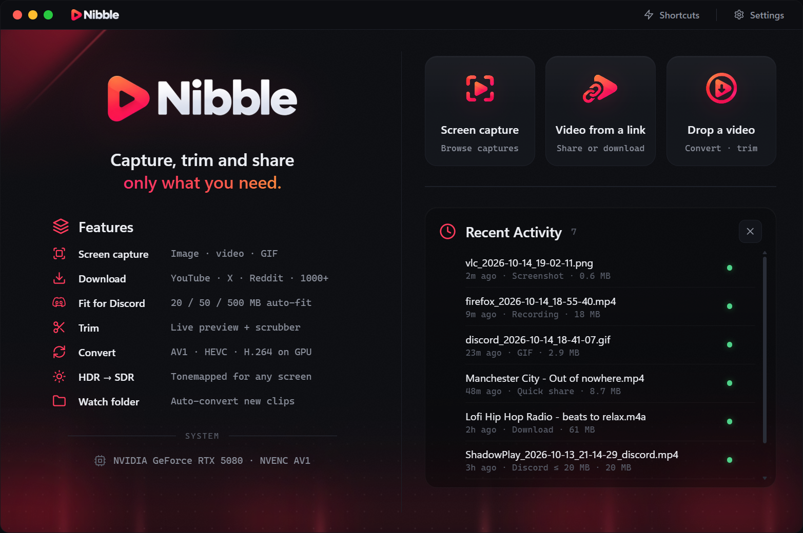

<p align="center">
  
</p>

<p align="center">
  <a href="https://github.com/xlzipx/nibble/releases/latest"></a>
  
  <a href="LICENSE"></a>
  <a href="https://tauri.app"></a>
</p>

# Nibble

**Capture, trim and share — only what you need.**
Screenshots and screen recordings with drawing tools, video downloads from 1000+ sites, trimming with a live preview and compression that fits Discord. For Windows 10 / 11.

**[⬇ Download the latest release](https://github.com/xlzipx/nibble/releases/latest)** — `Nibble-Setup` (installer) or `Nibble-Portable` (no install)

## Features

- **Screen capture** (`Ctrl+Shift+A`) — snaps to windows and their parts; draw rectangles, arrows, text, blur or pixelate; PNG / JPG / WebP
- **Screen recording** (`Ctrl+Shift+R`) — MP4 or GIF, system sound or mic, correct colours on HDR displays
- **Video from a link** — YouTube, X, Reddit, TikTok and 1000+ sites; download only the part you trim
- **Quick share** — the clip lands on your clipboard, ready for `Ctrl+V` in Discord or any chat
- **Fit for Discord** — compresses to 20 / 50 / 500 MB automatically
- **Convert** — AV1 / HEVC / H.264 on your GPU (NVIDIA, AMD, Intel), HDR → SDR
- **Watch folder** — new clips are converted automatically

## Install

1. Download `Nibble-Setup-v….exe` (or the portable `.exe`) from [Releases](https://github.com/xlzipx/nibble/releases/latest).
2. Windows SmartScreen may say "Unknown publisher" — click **More info → Run anyway** (the app isn't code-signed).
3. On first start Nibble checks for **ffmpeg** and **yt-dlp** and installs them with one click if they're missing.

## Build from source

Requires [Node.js](https://nodejs.org) and [Rust](https://rustup.rs).

```bash
npm install
npm run tauri build
```

Built with [Tauri 2](https://tauri.app) (Rust + WebView2), [ffmpeg](https://ffmpeg.org) and [yt-dlp](https://github.com/yt-dlp/yt-dlp).

## License

[MIT](LICENSE) © ZIPEEK
